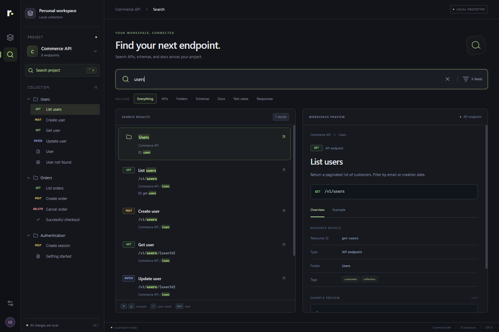
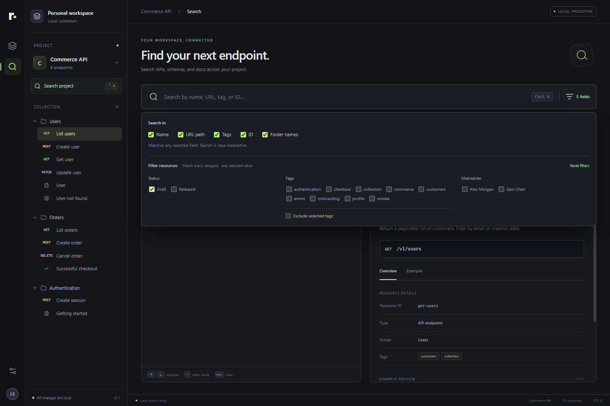
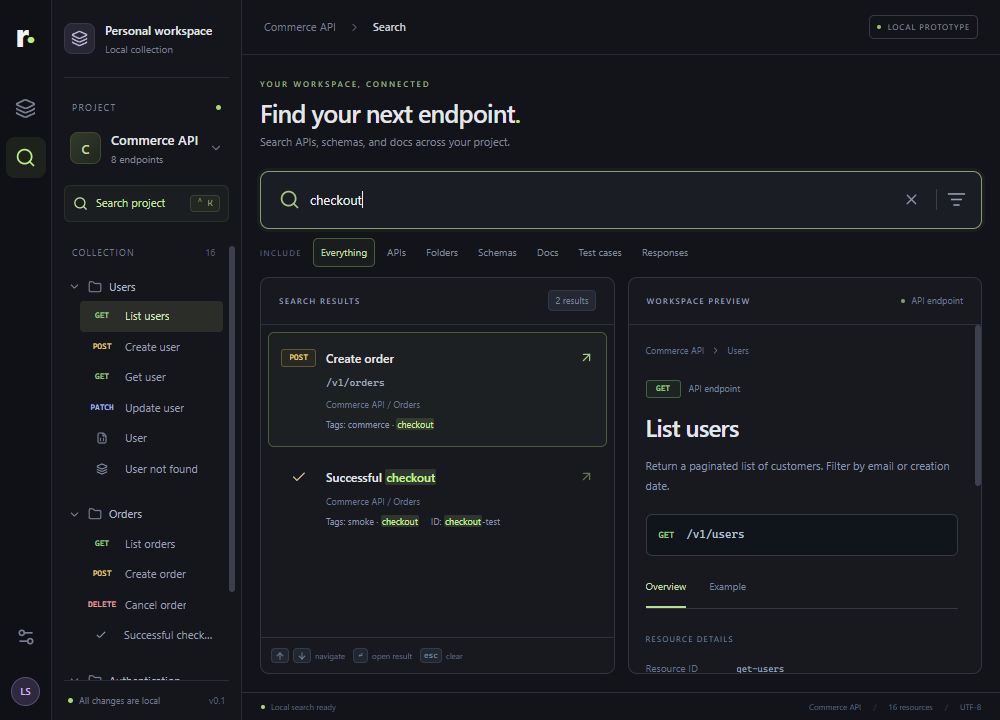

# Validation record

Validated on Windows, 2026-10-16 (America/Cuiaba), using Node 24.21.0. These checks exercise **Reqora**, not Apidog. Apidog evidence remains static artifact analysis.

| Check | Result |
| --- | --- |
| `pnpm typecheck` | Passed: TypeScript reports no errors. Also included in every production build. |
| `pnpm test` | **23 tests passed**, two files: 15 search/repository tests and eight renderer interaction tests. |
| `pnpm build` | Passed: electron-vite builds the Electron main process, sandbox-compatible CJS preload, and React/Tailwind renderer into `out/`. |
| `pnpm smoke:electron` | Passed: **10 checks against the actual built Electron application**, using an isolated temporary profile. No renderer page errors observed. |
| Visual inspection | Reviewed the full-size search view, metadata controls, and 1000 × 720 compact search view. The compact view has no horizontal document overflow. |

## Meaningful test coverage

Search tests exercise trimmed case-insensitive literal matching; phrase rather than token/fuzzy matching; separate tag/ancestor keywords; omitted method/body/description fields; selected fields/types; AND/OR metadata semantics and exclusion; blank and empty workspaces; parameterized paths and absolute URLs; escaped/anchored path behavior; Unicode highlighting, including contextual Greek casing; ancestry cycles/missing parents; replacement/deletion; clone isolation; and cancellation.

Renderer tests exercise Ctrl/Cmd+K, arrow/Enter/Escape navigation, saved query history, revealing collapsed folders, metadata-only searches, tag exclusion, maintainer selection, validated preference restoration, IME composition, stale asynchronous response suppression, literal markup rendering, later-tag highlight offsets, history clearing, and malformed/unavailable storage.

## Actual Electron smoke evidence

[smoke-result.json](evidence/reqora-runtime/smoke-result.json) records the ten successful checks:

1. Built Electron application loads the renderer and synthetic workspace.
2. The renderer has no `require` or `process` globals.
3. Ctrl+K focuses search; `users` returns seven resources.
4. `/v1/users/42` finds two parameterized endpoints; arrow/Enter opens the selected detail.
5. Escape clears text and exposes the committed query in recent history.
6. The recent query survives reload.
7. A blank-query Draft filter finds its endpoint and survives reload.
8. A query containing HTML is rendered as text without creating an image element.
9. Search remains usable at a 1000 × 720 content viewport without horizontal overflow.
10. No renderer page errors occur during the scenario.

The test creates a fresh temporary profile, launches only Reqora, and removes that owned profile after Electron exits. `REQORA_SMOKE_TEST=1` enables a hidden offscreen Electron window with background throttling disabled; normal app startup uses a regular window. Screenshots use Electron's `webContents.capturePage` after two renderer animation frames. This avoids stale or stalled captures from an ordinary hidden native window. The screenshots show rendered app content, not native window chrome.

## Runtime prerequisite

The default Electron package downloader stalled before receiving bytes in this environment. The exact Electron 44.8.0 Windows x64 archive was downloaded from the official GitHub release, verified against the package's SHA-256 manifest, and extracted into the local dependency directory. [runtime-acquisition.json](evidence/reqora-runtime/runtime-acquisition.json) preserves the URL and digest. No Apidog binaries were reused. The downloaded archive is an ignored local `.runtime/` artifact.

## Limits

- The prototype uses original synthetic workspace records; it is not a complete persisted API editor or request executor.
- The repository is asynchronous and replaceable, but main-process search IPC has not been implemented.
- Custom metadata fields, Apidog's full protocol-specific adapters, and its complete filtered-tree expansion lifecycle are outside this prototype. Exact differences are in [implementation-mapping.md](implementation-mapping.md).
- Neither these tests nor the screenshots establish how Apidog behaves at runtime. No Apidog live network requests or response bodies were captured.
